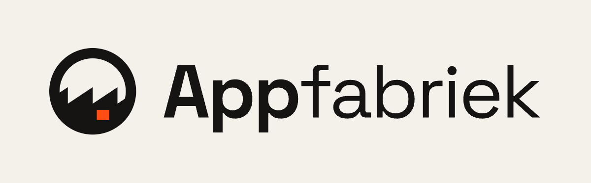

### A software factory with AI agents. One person.

With a factory full of AI agents, [Geert Rozendom](https://bvgeert.com) builds software and keeps it running. Apps for Business Central, apps for everyone, on European servers. They cost what they cost, plus 1%. The code stays in the owner's own repository.

Every app goes through the same stations: **Idea ⟶ Casco ⟶ Agents ⟶ Tests ⟶ Accept ⟶ Approval ⟶ Live**. No manual work, until a person has to decide. [Dok](https://appfabriek.com/dok/) checks every product every five minutes.

#### What the factory builds

| For companies on Business Central | For everyone | For organisations |
|---|---|---|
| [The Numbers](https://thenumbers.today): today's revenue in one number | [Tai Chi Guide](https://taichiguide.org): guided tai chi for people over 50 | [Coachlink](https://coachl.ink): coach and client, nobody else reads along |
| [thisdoc](https://thisdoc.online): a QR code on the work order, sign with your finger | [LivePlaylists](https://liveplaylists.com): your radio station as a Spotify playlist | [Kunstmarkt](https://kunstmarkt.app): applications, selection and stall plans in one app |
| [Weighbridge](https://weighbridge.app): drive on, your phone does the rest | [Agent Talk To Me](https://agenttalktome.com): talk to your agents, in the car too | [Short links](https://geert.link): on your own domain, with QR and stats |
| [Shopfloor](https://shopfloor.pro): production orders and machines on one screen | [lezen.in](https://lezen.in): a place for your book or handbook | |
| [Keur](https://keur.site): inspect where the batch is | | |

Where each product stands right now: **[the line on appfabriek.com ⟶](https://appfabriek.com/#lijn)**

#### Open source here

- [bc-claude-plugin](https://github.com/appfabriek/bc-claude-plugin): Claude skills for Microsoft Business Central development
- [agentlink](https://github.com/appfabriek/agentlink): chat from the app with your own agent (Claude Code, Codex, OpenClaw)
- [bvg](https://github.com/appfabriek/bvg): cross-platform fleet client

Appfabriek is the workshop of [p2tp](https://p2tp.org), power to the people: software that belongs to its users.

**[appfabriek.com ⟶](https://appfabriek.com)** · [businesscentral.software](https://businesscentral.software) · [support@appfabriek.com](mailto:support@appfabriek.com)
